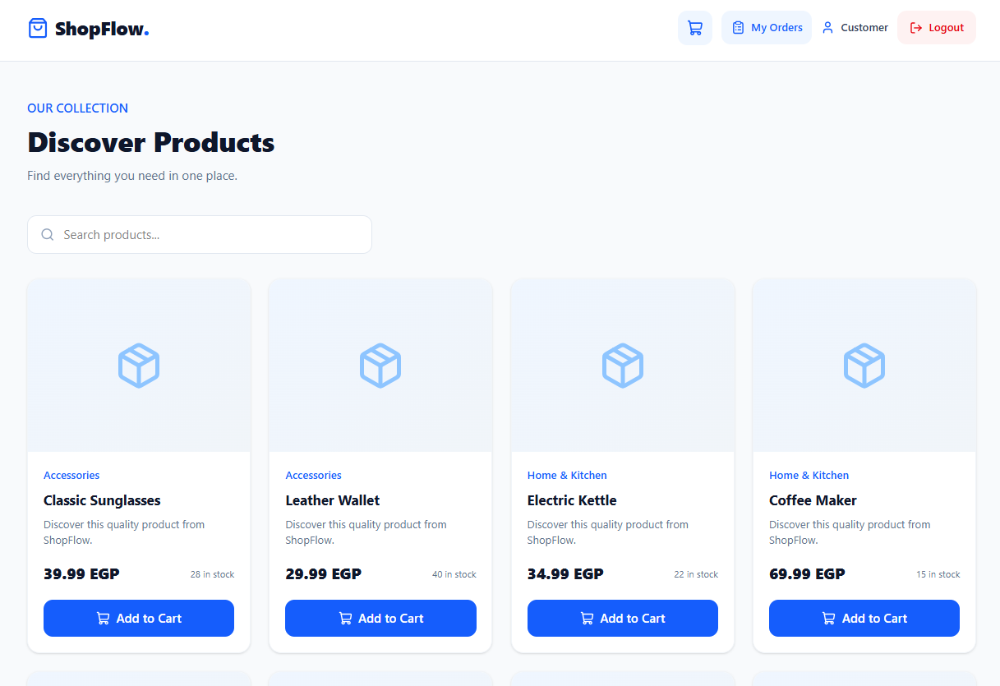
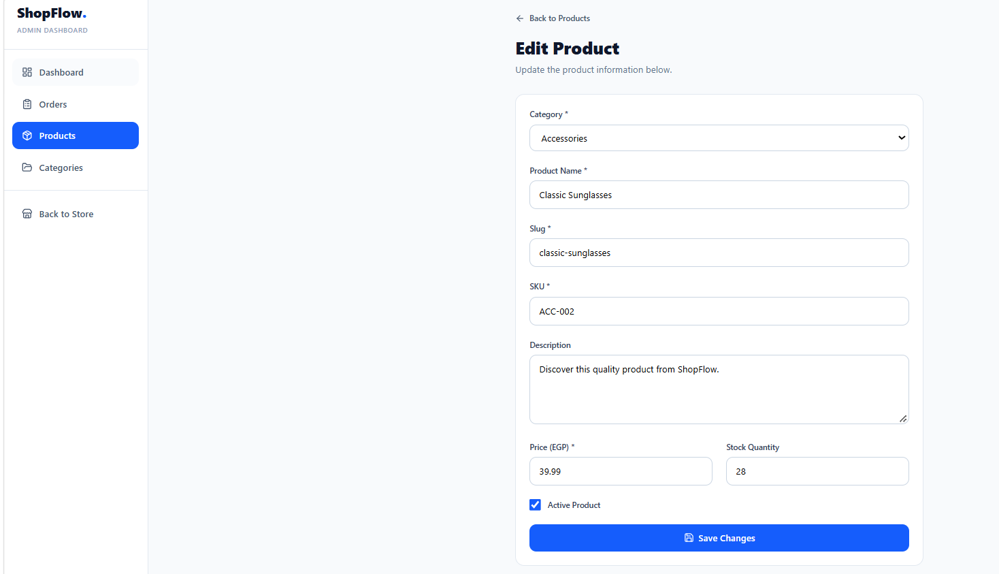
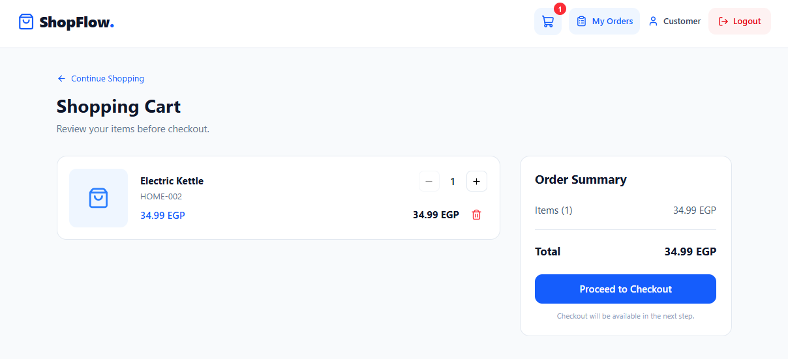
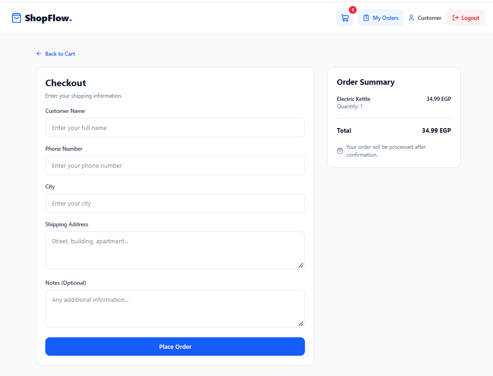
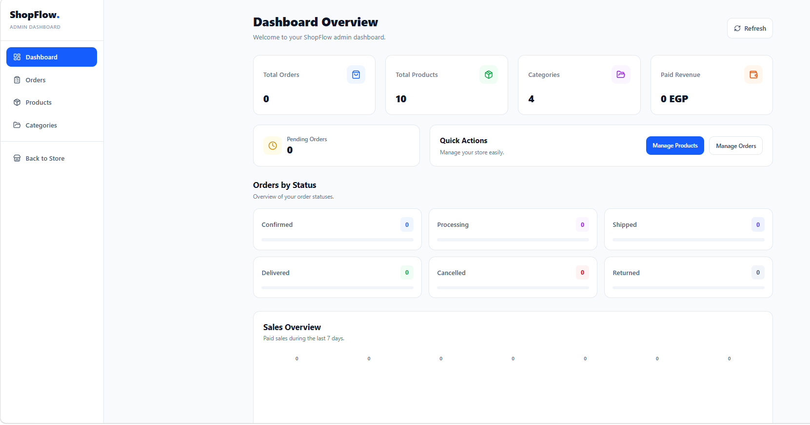
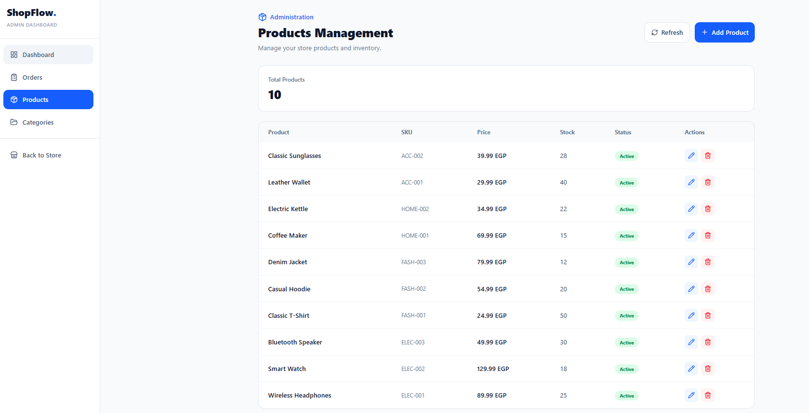
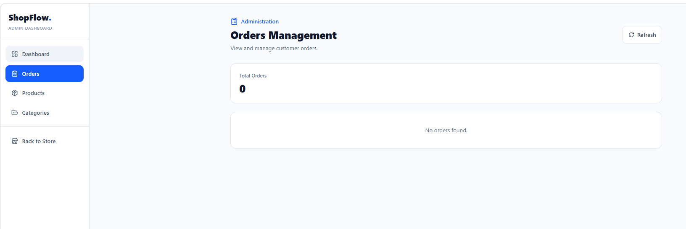

# ShopFlow — Full Stack E-Commerce Platform

A modern full-stack e-commerce application built with Laravel and React, featuring product browsing, shopping cart management, customer authentication, order processing, and an admin dashboard.

**Live Demo:** https://shopflow-ecommerce-pi.vercel.app  
**Backend API:** https://shopflow-ecommerce.ethiodeploy.app/api  
**Repository:** https://github.com/AymonMamd0uh/shopflow-ecommerce

## Overview

ShopFlow is a full-stack e-commerce platform designed to provide a smooth shopping experience for customers and an intuitive management interface for administrators.

The application uses a RESTful API architecture, with a React frontend communicating with a Laravel backend. Authentication and role-based authorization are handled using Laravel Sanctum.

## Features

### Customer Experience
- Browse products and categories.
- View individual product details.
- Search and explore the product catalog.
- Add products to the shopping cart.
- Update product quantities and remove cart items.
- Register and log in securely.
- Complete checkout.
- View personal orders and order details.

### Admin Dashboard
- Admin-only dashboard access.
- Manage products.
- Manage product categories.
- View and manage customer orders.
- Update order statuses.
- Update payment statuses.

### Authentication & Security
- Laravel Sanctum API authentication.
- Secure password hashing.
- Role-based access control (Admin / Customer).
- Protected customer and admin endpoints.
- Server-side request validation.


## Screenshots

### Storefront

| Home Page | Product Details |
|---|---|
|  |  |

### Shopping Experience

| Shopping Cart | Checkout |
|---|---|
|  |  |

### Admin Dashboard



### Products Management



### Orders Management




## Tech Stack

### Backend
- PHP
- Laravel 12
- Laravel Sanctum
- MySQL
- RESTful API

### Frontend
- React
- Vite
- Tailwind CSS
- Axios
- React Router

### Deployment
- Backend: EthioDeploy
- Frontend: Vercel
- Source Control: Git & GitHub

## Architecture

```text
React Frontend
      |
      | HTTP Requests / JSON
      v
Laravel REST API
      |
      | Eloquent ORM
      v
   MySQL Database
```

The frontend communicates with the backend through REST API endpoints. Protected endpoints require a valid Sanctum Bearer Token.

## API Overview

| Method | Endpoint | Description |
|---|---|---|
| POST | `/api/auth/register` | Register a customer |
| POST | `/api/auth/login` | Authenticate a user |
| GET | `/api/auth/me` | Get authenticated user |
| POST | `/api/auth/logout` | Revoke current token |
| GET | `/api/products` | List products |
| GET | `/api/products/{id}` | Get product details |
| GET | `/api/categories` | List categories |
| GET | `/api/cart` | Get customer cart |
| POST | `/api/cart/items` | Add cart item |
| POST | `/api/checkout` | Create an order |
| GET | `/api/orders` | List customer orders |
| GET | `/api/admin/orders` | List all orders (Admin) |

Additional admin endpoints support product, category, order, and payment-status management.

## Installation & Setup

### Prerequisites
- PHP 8.2 or later
- Composer
- Node.js and npm
- MySQL

### 1. Clone the repository

```bash
git clone https://github.com/AymonMamd0uh/shopflow-ecommerce.git
cd shopflow-ecommerce
```

### 2. Backend Setup

```bash
cd backend
composer install
```

Create your environment file:

```bash
cp .env.example .env
```

Configure your database connection in `.env`, then run:

```bash
php artisan key:generate
php artisan migrate --seed
php artisan serve
```

### 3. Frontend Setup

Open another terminal:

```bash
cd frontend
npm install
```

Create a `.env` file inside the frontend directory:

```env
VITE_API_URL=http://localhost:8000/api
```

Start the development server:

```bash
npm run dev
```

The frontend will be available at the local URL provided by Vite.

## Environment Variables

### Backend

Configure the database connection and other required Laravel environment variables in `backend/.env`.

For production admin provisioning, configure the required admin environment variables securely on the hosting provider. Never commit credentials or production secrets.

### Frontend

| Variable | Description |
|---|---|
| `VITE_API_URL` | Laravel API base URL |

## Testing

Authentication and authorization flows have been tested against the deployed API, including:

- Customer registration and login.
- Token-based authentication.
- Logout and token revocation.
- Customer access restrictions on admin endpoints.
- Admin access to protected endpoints.

## Deployment

- Frontend deployed on Vercel.
- Backend deployed on EthioDeploy.
- MySQL database configured for production.

## Author

**Ayman Mamdouh Elsayed**

Full Stack Web Developer | Backend Developer

- GitHub: https://github.com/AymonMamd0uh
- Portfolio: Add your portfolio URL here
- LinkedIn: Add your LinkedIn URL here

---

*Built as a full-stack portfolio project to demonstrate practical backend development, REST API design, frontend integration, authentication, and production deployment.*